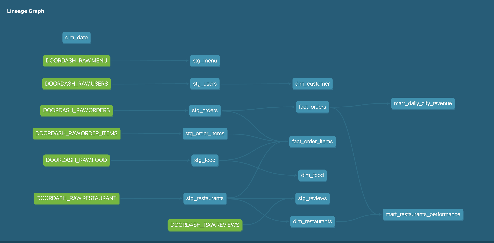

# Food Delivery Data Platform

An end-to-end batch data engineering project built on a DoorDash-style food delivery dataset. Raw CSVs are loaded into Snowflake, modelled with dbt into a star schema and marts, orchestrated daily by Airflow, and extended with LLM features: review enrichment, a review RAG chat, and a text-to-SQL app.

## Architecture

```
CSV files (data/)
   |  PUT to internal stage
   v
Snowflake  DOORDASH.RAW          <- COPY INTO (Airflow: reload_raw)
   |  dbt
   v
DOORDASH.STAGING (views)         <- cleaning, typing, dedup
   |  dbt
   v
DOORDASH.MART (tables)           <- dims, facts, marts
   |
   +--> enrich_reviews.py (OpenAI) --> DOORDASH.AI.REVIEW_ENRICHED
   +--> rag_chat.py        (Streamlit, embeddings over reviews)
   +--> text_to_sql.py     (Streamlit, natural language to SQL)
```

## Tech stack

| Layer | Tool |
|---|---|
| Warehouse | Snowflake |
| Transformation | dbt-core 1.8 + dbt-snowflake |
| Orchestration | Apache Airflow 3.0.3 (LocalExecutor, Docker Compose, Postgres metadata DB) |
| AI | OpenAI (`gpt-4o-mini`, `text-embedding-3-small`) |
| App layer | Streamlit |
| Language / tooling | Python 3.12, `uv` |

## Repository layout

```
.
├── airflow/
│   ├── dags/doordash_batch.py     # daily DAG
│   ├── ai/                        # enrichment, RAG chat, text-to-SQL scripts
│   ├── Dockerfile                 # Airflow + Snowflake provider + isolated dbt venv
│   └── docker-compose.yaml        # api-server, scheduler, dag-processor, postgres
├── doordash_dbt/
│   ├── models/
│   │   ├── sources/               # RAW source definitions
│   │   ├── staging/               # stg_* views + unique/not_null tests
│   │   └── mart/                  # dim_*, fact_*, mart_* tables
│   ├── macros/macros1.sql         # generate_schema_name override
│   └── dbt_project.yml
├── data/                          # source CSVs (not for version control)
├── pictures/                      # README images (dbt lineage graph)
├── pyproject.toml / uv.lock
└── README.md
```

## Data

Seven source tables land in `DOORDASH.RAW`:

| File | Description | Approx. size |
|---|---|---|
| `orders.csv` | One row per order: city, cuisine, amounts, status, rating, delivery time | 1.3 GB |
| `order_items.csv` | Line items per order | 955 MB |
| `menu.csv` | Restaurant to food mapping with price | 66 MB |
| `restaurant.csv` | Restaurant name, city, rating, cost, cuisine | 47 MB |
| `reviews.csv` | Customer review text and rating | 25 MB |
| `food.csv` | Food items, veg / non-veg | 17 MB |
| `users.csv` | Customer demographics | 11 MB |

## dbt models

**Staging** (views, schema `STAGING`): `stg_food`, `stg_menu` (deduplicated on `menu_id`), `stg_order_items`, `stg_orders` (city parsed from the address string, `is_delivered` flag), `stg_restaurants` (numeric parsing of rating, rating count and cost), `stg_reviews` (joined to restaurant city), `stg_users`. Every primary key has `unique` and `not_null` tests.

**Mart** (tables, schema `MART`):

| Model | Type | Notes |
|---|---|---|
| `dim_customer` | dimension | Age buckets added |
| `dim_restaurants` | dimension | |
| `dim_food` | dimension | |
| `dim_date` | dimension | Generated date spine, 2024-01-01 to 2026-12-31 |
| `fact_orders` | fact | Incremental merge on `order_id`, 3-day lookback |
| `fact_order_items` | fact | Incremental merge on `order_item_id`, 3-day lookback |
| `mart_daily_city_revenue` | mart | Orders, cancel rate, delivered revenue and AOV by day and city |
| `mart_restaurants_performance` | mart | Orders, sales, avg delivery time and rating per restaurant |

### Lineage



Generated with `dbt docs generate && dbt docs serve`.

## Airflow DAG: `doordash_batch`

Runs `@daily`, no catch-up.

```
reload_raw >> dbt_build_core >> enrich_reviews >> dbt_build_ai
```

1. **reload_raw**: `COPY INTO` each RAW table from the internal stage `DOORDASH.RAW.DOORDASH_INTERNAL_STAGE`.
2. **dbt_build_core**: `dbt build --exclude tag:ai` (models and tests).
3. **enrich_reviews**: classifies reviews not yet enriched with OpenAI and writes sentiment, topic and key issue to `DOORDASH.AI.REVIEW_ENRICHED`. Batch size is set by `SAMPLE_N`.
4. **dbt_build_ai**: `dbt build --select tag:ai` for models built on the enrichment output.

## AI features

- **Review enrichment** (`airflow/ai/enrich_reviews.py`): returns `sentiment_label`, `sentiment_score`, `topic` and `key_issue` per review as JSON.
- **Review RAG chat** (`airflow/ai/rag_chat.py`): embeds a sample of reviews, retrieves the top 5 by cosine similarity, and answers only from those reviews. Embeddings are cached in `review_embeddings.parquet`.
- **Text-to-SQL** (`airflow/ai/text_to_sql.py`): the LLM writes a single `SELECT` from a schema description. The query is checked against a forbidden-keyword list before it runs.

## Getting started

### Prerequisites

- Docker and Docker Compose
- [uv](https://docs.astral.sh/uv/) and Python 3.12
- A Snowflake account with a warehouse and role that can read and write `DOORDASH`
- An OpenAI API key

### 1. Install dependencies

```bash
uv sync
```

### 2. Configure credentials

Create `airflow/.env` and `airflow/ai/.env` with:

```
SNOWFLAKE_ACCOUNT=<account>
SNOWFLAKE_USER=<user>
SNOWFLAKE_PASSWORD=<password>
SNOWFLAKE_WAREHOUSE=<warehouse>
SNOWFLAKE_DATABASE=DOORDASH
SNOWFLAKE_SCHEMA=RAW
OPENAI_API_KEY=<key>
```

Set the same Snowflake details in `doordash_dbt/profiles.yml`, ideally via `{{ env_var('...') }}` rather than literals. Do not commit any of these files.

### 3. Load the raw data

Upload the CSVs in `data/` to `@DOORDASH.RAW.DOORDASH_INTERNAL_STAGE/<table>/` and create the RAW tables, then let `reload_raw` run the `COPY INTO` statements.

### 4. Run dbt on its own

```bash
cd doordash_dbt
dbt deps
dbt build
dbt docs generate && dbt docs serve
```

### 5. Start Airflow

```bash
cd airflow
docker compose build
docker compose up -d
```

### 6. Run the Streamlit apps

```bash
cd airflow/ai
streamlit run rag_chat.py
streamlit run text_to_sql.py
```
